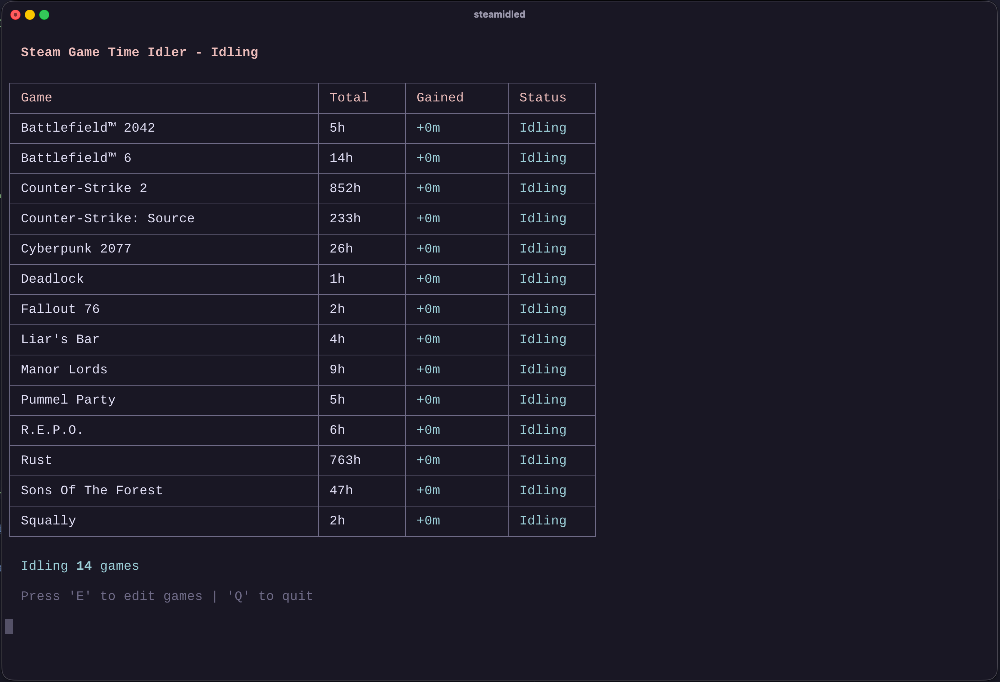
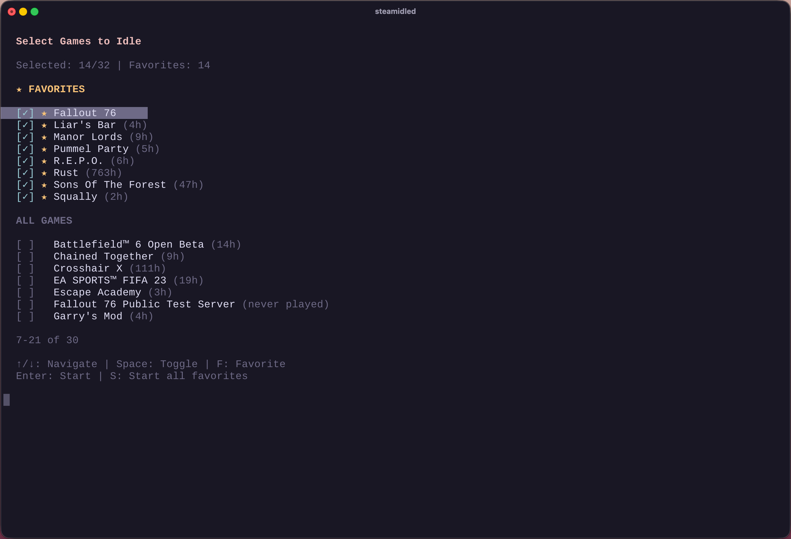

<p align="center">
  
</p>

# steamidled 🎮💤

[](https://www.npmjs.com/package/@louisraetz/steamidled)
[](https://www.npmjs.com/package/@louisraetz/steamidled)

Steam game idler CLI and daemon. Rack up playtime while you touch grass. Run up to 32 games simultaneously, collect trading cards, and finally look like you have no life (in a good way).

<p align="center">
  
  
</p>

## ✨ Why does this exist?

This is a hobby project, born from a weekend of vibe coding and questionable life choices. I wanted more hours in games I'll never actually play, and here we are.

Built with love, caffeine, and Claude. No regrets. 🤖☕

## 🚀 Features

- **📱 QR Code Login** — Scan with Steam mobile app
- **🔐 Traditional Login** — Username/password with Steam Guard (for the old school folks)
- **🌐 Web GUI** — Log in, pick games, start and stop, and watch live progress and logs from your browser. Great for servers and Docker
- **🎯 Idle up to 32 games** — Because Steam said that's the limit and who are we to argue
- **🎲 Smart cooldowns** — Games cycle between random idle and cooldown phases so playtime totals naturally diverge instead of looking suspiciously identical
- **♾️ Exempt one game** — Pick a favorite that ignores cooldowns and idles forever
- **🩹 Auto-recovery** — Survives connection drops, Steam outages, and session takeovers. Pings Telegram once and reconnects on its own with exponential backoff. Gives up only on unrecoverable errors (expired token, ban, protocol mismatch) or after 30 failed reconnects. `--web` never gives up and asks you to sign in again in the browser
- **🔑 Token renewal** — Refresh tokens expire after a few months; the daemon renews and saves them on its own so it keeps running
- **📲 Telegram notifications** — Optional bot pings on stop/resume + daily midnight stats
- **🔍 Search & filter** — Type `/` to search by name, `T` to cycle owned / free / family-shared
- **👨‍👧 Family-shared library** — Idle games shared with you, tagged with a `↪` badge
- **📊 Real-time tracking** — Watch numbers go up. Dopamine achieved.
- **⭐ Favorites system** — Star your favorites so you can pretend you're organized
- **⏸️ Auto-pause** — Play something on another device and idling freezes until you stop (Steam blocks the whole session, so the clocks stop too). Picks up again on its own
- **💾 Persistent sessions** — Remembers your login so you don't have to

## 📦 Installation

### npm

```bash
npm install -g @louisraetz/steamidled
```

## 🎮 Usage

```bash
steamidled                  # Interactive mode
steamidled --headless       # Headless mode (auto-start favorites)
steamidled --web            # Headless mode with a web GUI
steamidled --setup-telegram # (Re)configure Telegram notifications
steamidled --logout         # Forget the saved Steam login
steamidled --help           # All options
```

### Interactive mode

1. **Pick your login method** — QR code is chef's kiss 👨‍🍳💋
2. **Select your games** — Go wild, pick all of them, I won't judge
3. **Watch the hours roll in** — This is what peak productivity looks like

### Headless mode

Automatically logs in and starts idling your favorited games (the first 32 if you starred more). Perfect for running as a service. Requires running interactively first to log in and set up favorites. A network blip or rate limit at startup keeps your saved login; only a genuinely expired or revoked token makes you log in again.

### 📲 Telegram notifications (optional)

Get pings when idling stops/resumes and a daily snapshot (local midnight unless you pick another hour).

1. Create a bot via [@BotFather](https://t.me/BotFather) and grab its token.
2. The first time you run `steamidled` interactively, it'll ask if you want to configure Telegram. Say yes, paste your token when prompted, send `/start` to your bot in Telegram, and press Enter.
3. To (re)configure later — e.g. new bot, new chat — run: `steamidled --setup-telegram`, or use Settings in the web GUI.

Token + chat id live in `~/.steam-idler/telegram.json`. Picking "no" the first time stores `{ "disabled": true }` so the prompt won't bother you again.

Too chatty? Settings in the web GUI switches each kind below on or off, sends a test message and sends the daily report on demand. The choice is stored as `notify` in `telegram.json`, so the CLI respects it too. Messages about idling stopping for good always come through.

What you'll get:

| Message | When |
|---------|------|
| ▶️ Idling started | On start, with the game count and the exempt game |
| ⏸️ Idling paused | A disconnect or takeover that lasts longer than 30s (short blips stay silent) |
| ▶️ Idling resumed after … | Once the reconnect has held for 90s |
| 🔄 flush | Every 4h (configurable): a quick relog that makes Steam commit the playtime |
| ⚠️ Zombie session | Steam stopped crediting playtime; the idler forces a reconnect |
| 📊 Daily idling report | Local midnight (configurable): today's gain per game, cooldowns, exempt |
| 🛑 Idling stopped | Quit, crash, unrecoverable Steam error, a failed headless start, or Stop / Log out in the web GUI |

## 🌐 Web GUI

Rather click than type? `--web` runs the headless daemon plus a web GUI:

```bash
steamidled --web
```

Open http://127.0.0.1:4821. From there you can log in (QR or password + Steam Guard), pick games and apply them in one go, mark auto-start games (the CLI's ⭐ favorites), give one game no cooldown (the CLI's ∞ exempt), set up Telegram, and watch progress and logs live. The ⋯ menu on each game sends it into a cooldown now, ends a cooldown early or moves the next one. No interactive first run needed: without a saved login it simply waits for you in the browser.

Your picks survive restarts, cooldown progress included. Only the very first start and a sign-in after logging out idle your first 32 auto-start games.

| Variable | Default | What it does |
|----------|---------|--------------|
| `STEAMIDLED_WEB_PORT` | `4821` | Port of the GUI |
| `STEAMIDLED_WEB_HOST` | `127.0.0.1` | Address to listen on. `0.0.0.0` opens it to your network |
| `STEAMIDLED_WEB_ALLOWED_HOSTS` | | Comma-separated domains you reach the GUI by, e.g. `idle.example.com`. `localhost` and IP addresses always work |

> ⚠️ The GUI has no login of its own. Whoever can open it controls your Steam session. Keep it on localhost or your LAN, or put it behind a reverse proxy with authentication.

Behind nginx, add `proxy_set_header Host $host;` and `proxy_buffering off;` so actions work and live updates arrive instantly.

Port already taken, for example by a second `steamidled --web`? It exits right away with code 2 and says so.

### ⚙️ Settings

The Settings page in the web GUI picks the [schedule profile](#-how-the-randomizer-works) (or turns cooldowns off), how often playtime gets committed, the watchdog, your Steam status, the daily report hour and the Telegram messages. It saves to `~/.steam-idler/settings.json`, and interactive and `--headless` mode read the same file at startup. Every field is optional, missing ones use these defaults:

```json
{
  "schedule": {
    "enabled": true,
    "profile": "daily"
  },
  "flushIntervalHours": 4,
  "watchdog": true,
  "personaState": "online",
  "dailyReportHour": 0
}
```

`profile` is `weekend`, `daily`, `grinder` or `custom`. Only `custom` reads `idleMinHours`, `idleMaxHours`, `cooldownMinHours` and `cooldownMaxHours`, all four in hours. A file with these ranges but no `profile` counts as `custom`, so an older settings file keeps its rhythm, and missing ranges use the old defaults of 168, 720, 100 and 200 hours. `flushIntervalHours` is one of 1, 2, 4, 6, 8 or 12, `personaState` is `online`, `away` or `offline`. A broken value falls back to its default with a warning in the log.

The library updates itself. When Steam reports a new license, like a purchase, a gift or a free game, the web GUI reloads your games about 15 seconds later, at most once every 5 minutes. The Refresh button stays for when you don't want to wait.

## ⌨️ Controls

### Game Selection

| Key | What it does |
|-----|--------------|
| `↑` `↓` | Navigate (you got this) |
| `Space` | Toggle game on/off |
| `F` | Favorite a game ⭐ |
| `X` | Mark as exempt from the randomizer ♾️ |
| `T` | Cycle source filter (all / owned / free / family-shared) |
| `/` | Search by name (case-insensitive, Esc to clear) |
| `PgUp` `PgDn` `Home` `End` | Jump through long libraries |
| `S` | Start all favorites |
| `Enter` | Let's gooo 🚀 (does nothing while nothing is selected) |
| `Esc` | In edit mode: back to idling, selection unchanged |

### While Idling

| Key | What it does |
|-----|--------------|
| `E` | Edit your selection (changed your mind?) |
| `Q` | Quit gracefully (like a gentleman) |
| `Ctrl+C` | Rage quit |

## 🎲 How the randomizer works

Idling all your games full-throttle for a month gives them suspiciously identical hour counts. To avoid that, every game runs on its own private schedule:

- **Idle phase** — a random stretch of active idling
- **Cooldown phase** — a random break where the game drops out of the rotation
- After cooldown, the game rejoins the idle pool with a fresh idle-phase target and the cycle repeats

How long each phase lasts comes from the schedule profile:

| Profile | Idle phase | Cooldown | Collects about |
|---------|------------|----------|----------------|
| Weekend | 1–3 days | 4–6 days | 30% of the time |
| Daily (default) | 3–10 days | 1–3 days | 75% of the time |
| Grinder | 20–60 days | 6–24 hours | 98% of the time |
| Custom | your own ranges | your own ranges | |

Earlier versions always used 7–30 days of idling and 100–200 hours of cooldown. A settings file from back then keeps that rhythm as Custom. On a fresh setup, pick Custom in [Settings](#️-settings) and set those ranges, or switch cooldowns off to idle nonstop. Switching to a profile gives every running game a new schedule right away. Custom starts from your last custom ranges, or from the profile you had, and applies from each game's next phase.

Run for a month and your library ends up with naturally varied playtime instead of one tell-tale plateau.

Want one game that just idles forever? Hit `X` on it in the selector — it gets marked with `∞`, skips cooldowns entirely, and idles for as long as the process is running. Only one game can be exempt at a time.

## 🐧 Running 24/7 on Linux

Want to idle games while you sleep? Same. Run it as a systemd service with `--headless` mode.

### Prerequisites

1. Run the tool interactively once to log in and set up favorites
2. Find where it lives: `which steamidled`

### Create the Service

```bash
sudo nano /etc/systemd/system/steamidled.service
```

```ini
[Unit]
Description=steamidled
After=network-online.target
Wants=network-online.target

[Service]
Type=simple
User=YOUR_USERNAME
ExecStart=/usr/bin/steamidled --headless
Restart=on-failure
RestartSec=10
# exit 2 = nothing a restart can fix: no saved login, no favorites, expired or
# revoked token, banned account, protocol mismatch. exit 1 = transient, restart.
RestartPreventExitStatus=2

[Install]
WantedBy=multi-user.target
```

Replace `YOUR_USERNAME` with your username.

### Fire it up

```bash
sudo systemctl daemon-reload
sudo systemctl enable steamidled
sudo systemctl start steamidled
```

### Useful commands

```bash
sudo systemctl status steamidled   # Is it alive?
journalctl -u steamidled -f        # What's it thinking?
sudo systemctl stop steamidled     # Take a break
sudo systemctl restart steamidled  # Turn it off and on again
```

### Prefer the web GUI?

Use `ExecStart=/usr/bin/steamidled --web` instead and skip the interactive first run: you log in from the browser. The GUI only listens on the server's `127.0.0.1`, so open an SSH tunnel from your machine and browse to http://127.0.0.1:4821:

```bash
ssh -L 4821:127.0.0.1:4821 you@your-server
```

## 🐳 Docker

Prefer containers? The repo ships a `Dockerfile` and a `docker-compose.yml`. The image runs as the unprivileged `node` user, starts the [web GUI](#-web-gui) by default and keeps everything in a named volume mounted at `/home/node/.steam-idler`.

```bash
git clone https://github.com/louisraetz/steamidled.git && cd steamidled

# Start it, then open http://127.0.0.1:4821 and log in from the browser
docker compose up -d

# Later
docker compose logs -f                                   # What's it thinking?
docker compose run --rm steamidled --logout              # Forget the saved login
docker compose down                                      # Stop (clean logoff, Telegram ping)
```

The GUI is published on `127.0.0.1` only. For a different host port, set `STEAMIDLED_WEB_PORT` in a `.env` file next to `docker-compose.yml` or in your shell (`STEAMIDLED_WEB_PORT=8080 docker compose up -d`), never under `environment:`. Inside the container the GUI always listens on 4821.

Terminal person? `docker compose run --rm -it steamidled login` gives you the interactive mode (QR works in the terminal), and `command: idle` in `docker-compose.yml` runs the plain headless daemon without a GUI.

Set `TZ` in `docker-compose.yml` to your timezone, otherwise the daily report arrives at UTC midnight. The restart policy is `on-failure:5` on purpose: Docker has no equivalent of systemd's `RestartPreventExitStatus`, so a config problem (exit 2) gives up after a few tries instead of logging on to Steam every few seconds forever, while transient failures keep restarting.

### Coolify

1. Create an application from this repo with the **Dockerfile** build pack.
2. Set the exposed port to `4821` and leave the port mappings empty. Coolify's proxy routes your domain to the container.
3. Add persistent storage at `/home/node/.steam-idler`, otherwise every redeploy logs you out.
4. Set your domain and add `STEAMIDLED_WEB_ALLOWED_HOSTS=your.domain`. A plain "Host not allowed" page means this is missing.
5. Turn on **HTTP Basic Authentication** under Configuration → General, or keep the domain reachable from your LAN only. The GUI has no login of its own.

## 📁 Where's my stuff?

Everything lives in `~/.steam-idler/` (inside Docker: the `steamidled-config` volume):

```
~/.steam-idler/
├── credentials.json          # Your login token (keep it secret 🤫)
├── favorites-{username}.json # Your favorites + exempt game pick
├── session-{username}.json   # Web GUI: the games idling right now, restored after a restart
├── settings.json             # Optional schedule profile, flush interval, report hour, ...
└── telegram.json             # Optional Telegram bot token + chat id
```

## 📋 Requirements

- Node.js 20+ (we're modern here)
- A Steam account with games (shocking, I know)
- Steam mobile app (optional, but makes login ✨fancy✨)

## 🤝 Contributing

Found a bug? Have an idea? PRs welcome! This is a hobby project so I might be slow, but I appreciate you. 💙

## ⚠️ Disclaimer

This is just a fun side project. Use responsibly. I'm not responsible if Valve gets mad at you or whatever. Probably don't idle 10,000 hours in a game you've never launched. Or do. I'm not your mom.

## 📄 License

MIT — Do whatever you want with it ✌️

---

*Made with mass vibe coding energy* 🌊✨
