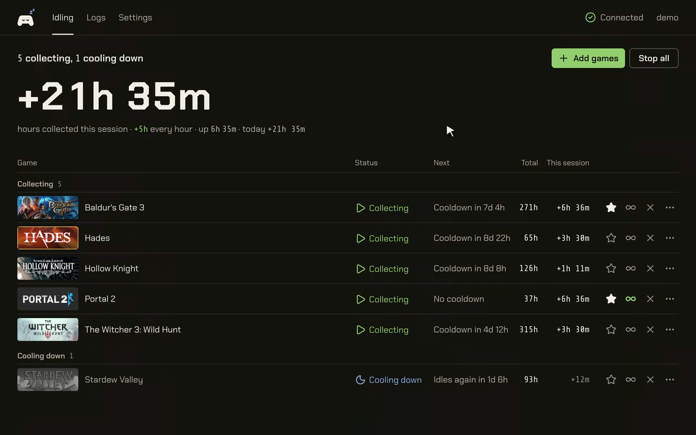

<p align="center">
  
</p>

<h1 align="center">steamidled</h1>

<p align="center">
  Idle up to 32 Steam games at once from your terminal, a server or a Docker container.<br />
  Random idle and cooldown phases keep the hours looking human.
</p>

<p align="center">
  <a href="https://www.npmjs.com/package/@louisraetz/steamidled"></a>
  <a href="https://www.npmjs.com/package/@louisraetz/steamidled"></a>
  
  <a href="LICENSE"></a>
</p>

<p align="center">
  
</p>

<p align="center">
  <a href="#quick-start">Quick start</a> ·
  <a href="#installation">Installation</a> ·
  <a href="#usage">Usage</a> ·
  <a href="#web-gui">Web GUI</a> ·
  <a href="#configuration">Configuration</a> ·
  <a href="#how-it-works">How it works</a> ·
  <a href="#faq">FAQ</a>
</p>

## Features

- **32 games at once**, the most Steam allows per account.
- **Hours that look human.** Every game alternates between its own random idle and cooldown phases, so a month of idling doesn't leave the same number on every game. Pick a Weekend, Daily or Grinder rhythm, or set your own ranges.
- **Three ways to run it:** an interactive terminal UI, a headless daemon, or the daemon with a web GUI.
- **QR code login** with the Steam mobile app, or username, password and Steam Guard. Only a refresh token is stored, and it renews itself.
- **Runs unattended.** Reconnects after network drops, Steam outages and session takeovers, pauses while you play on another device and makes sure Steam actually records the hours.
- **Telegram notifications** when idling stops or resumes, plus a daily report.
- **Docker and Coolify ready:** unprivileged image, healthcheck, config in a volume.
- Owned, free and family-shared games, with search and filters.

## Quick start

```bash
npm install -g @louisraetz/steamidled
steamidled
```

Choose **QR Code**, scan it with the Steam app, pick your games and press Enter. Rather use a browser? Run `steamidled --web` and open http://127.0.0.1:4821.

Requires Node.js 20 or newer.

## Installation

### npm

```bash
npm install -g @louisraetz/steamidled
```

### Docker Compose

The repo ships a `Dockerfile` and a `docker-compose.yml`. The container runs the [web GUI](#web-gui) as the unprivileged `node` user and keeps everything in the `steamidled-config` volume.

```bash
git clone https://github.com/louisraetz/steamidled.git && cd steamidled
docker compose up -d
```

Open http://127.0.0.1:4821 and log in from the browser.

```bash
docker compose logs -f                        # follow the logs
docker compose run --rm steamidled --logout   # forget the saved login
docker compose down                           # stop with a clean logoff
```

- The GUI is published on `127.0.0.1` only. For another host port, set `STEAMIDLED_WEB_PORT` in a `.env` file next to `docker-compose.yml` or in your shell (`STEAMIDLED_WEB_PORT=8080 docker compose up -d`), not under `environment:`. Inside the container the GUI always listens on 4821.
- Set `TZ` in `docker-compose.yml` to your timezone, otherwise the daily report arrives at UTC midnight.
- Prefer the terminal? `docker compose run --rm -it steamidled login` starts the interactive mode, and `command: idle` runs the headless daemon without a GUI.
- The restart policy is `on-failure:5` on purpose. A configuration problem exits with code 2 and gives up after a few tries instead of logging on to Steam forever, while transient failures keep restarting.

### Coolify

1. Create an application from this repo with the **Dockerfile** build pack.
2. Set the exposed port to `4821` and leave the port mappings empty.
3. Add persistent storage at `/home/node/.steam-idler`, otherwise every redeploy logs you out.
4. Set your domain. If the GUI answers "Host not allowed", add `STEAMIDLED_WEB_ALLOWED_HOSTS=your.domain`.
5. Turn on **HTTP Basic Authentication** under Configuration → General, or keep the domain reachable from your LAN only. The GUI has no login of its own.

<details>
<summary>Build from source</summary>

```bash
git clone https://github.com/louisraetz/steamidled.git && cd steamidled
pnpm install
pnpm build
node dist/index.js --help
```

</details>

## Usage

```bash
steamidled                   # interactive terminal UI
steamidled --headless        # daemon, idles your auto-start games
steamidled --web             # daemon with the web GUI on port 4821
steamidled --setup-telegram  # set up or change Telegram notifications
steamidled --logout          # forget the saved Steam login
steamidled --version         # print the version
steamidled --help            # list all options
```

### Interactive mode

<p align="center">
  
</p>

Log in, pick your games, press Enter. Your login and favorites are saved, so the next start takes two key presses.

| Key | Game selection |
|-----|----------------|
| `↑` `↓` `PgUp` `PgDn` `Home` `End` | Move through the list |
| `Space` | Select or deselect a game |
| `F` | Mark as favorite. Favorites start automatically in headless mode |
| `X` | Skip cooldowns for this game. One game at a time |
| `T` | Cycle the filter: all, owned, free, family-shared |
| `/` | Search by name, `Esc` clears |
| `S` | Start all favorites |
| `Enter` | Start idling |

| Key | While idling |
|-----|--------------|
| `E` | Change the selection |
| `Q` | Quit with a clean logoff |
| `Ctrl+C` | Quit right away |

### Headless mode

`steamidled --headless` logs in with the saved login and idles your favorites, the first 32 if you marked more. Run the interactive mode once first to log in and choose favorites. A network blip or rate limit at startup keeps the saved login. Only an expired or revoked token asks you to log in again.

### Running as a service

On Linux, run the headless mode under systemd. Find the binary with `which steamidled` and create `/etc/systemd/system/steamidled.service`:

```ini
[Unit]
Description=steamidled
After=network-online.target
Wants=network-online.target

[Service]
Type=simple
User=YOUR_USERNAME
ExecStart=/usr/bin/steamidled --headless
Restart=on-failure
RestartSec=10
RestartPreventExitStatus=2

[Install]
WantedBy=multi-user.target
```

```bash
sudo systemctl daemon-reload
sudo systemctl enable --now steamidled
journalctl -u steamidled -f
```

Exit code 2 means a restart can't fix it: no saved login, no favorites, an expired or revoked token, a banned account or a protocol mismatch. Exit code 1 is transient, so systemd restarts it.

To manage the service from a browser instead, use `ExecStart=/usr/bin/steamidled --web` and skip the interactive first run. The GUI listens on the server's `127.0.0.1`, so reach it through an SSH tunnel:

```bash
ssh -L 4821:127.0.0.1:4821 you@your-server
```

## Web GUI

`steamidled --web` runs the headless daemon plus a web GUI at http://127.0.0.1:4821. From there you can:

- log in with a QR code or with password and Steam Guard, no interactive first run needed
- pick games and apply them in one go, and mark auto-start games
- give one game no cooldown, send a game into a cooldown now, end one early or move the next one
- choose a schedule profile, your Steam status, the commit interval and the daily report hour
- set up Telegram and pick which messages you get
- follow progress and logs live

Your selection and each game's cooldown progress survive restarts. Only the very first start and a sign-in after logging out begin with your first 32 auto-start games.

| Variable | Default | Description |
|----------|---------|-------------|
| `STEAMIDLED_WEB_PORT` | `4821` | Port of the GUI |
| `STEAMIDLED_WEB_HOST` | `127.0.0.1` | Address to listen on. `0.0.0.0` opens it to your network |
| `STEAMIDLED_WEB_ALLOWED_HOSTS` | | Comma-separated domains you open the GUI on, for example `idle.example.com`. `localhost` and IP addresses always work |

> [!WARNING]
> The GUI has no login of its own. Whoever can open it controls your Steam session. Keep it on localhost or your LAN, or put it behind a reverse proxy with authentication.

Behind nginx, add `proxy_set_header Host $host;` and `proxy_buffering off;` so actions work and live updates arrive right away. If the port is taken, for example by a second `steamidled --web`, it exits with code 2 and says so.

## Configuration

### Schedule profiles

Idling every game nonstop for a month gives them all the same hour count. Instead, every game runs on its own schedule: a random idle phase, then a random cooldown where it drops out, then a new idle phase. Pick the rhythm in the web GUI under Settings → Schedule.

| Profile | Idle phase | Cooldown | Collects about |
|---------|------------|----------|----------------|
| Weekend | 1–3 days | 4–6 days | 30% of the time |
| Daily (default) | 3–10 days | 1–3 days | 75% of the time |
| Grinder | 20–60 days | 6–24 hours | 98% of the time |
| Custom | your ranges | your ranges | |

Switching profiles gives every running game a new schedule right away. One game can skip cooldowns entirely (`X` in the terminal, ∞ in the web GUI), and you can turn cooldowns off to idle everything nonstop.

### settings.json

The web GUI saves its settings to `~/.steam-idler/settings.json`. Interactive and headless mode read the same file at startup. Every field is optional. These are the defaults:

```json
{
  "schedule": {
    "enabled": true,
    "profile": "daily"
  },
  "flushIntervalHours": 4,
  "watchdog": true,
  "personaState": "online",
  "dailyReportHour": 0
}
```

| Field | Values |
|-------|--------|
| `schedule.enabled` | `false` idles nonstop without cooldowns |
| `schedule.profile` | `weekend`, `daily`, `grinder` or `custom` |
| `schedule.idleMinHours`, `idleMaxHours`, `cooldownMinHours`, `cooldownMaxHours` | Ranges in hours, only read for `custom` |
| `flushIntervalHours` | How often playtime gets committed: `1`, `2`, `4`, `6`, `8` or `12` |
| `watchdog` | Checks that Steam keeps counting and reconnects if it stops |
| `personaState` | Your Steam status while idling: `online`, `away` or `offline` |
| `dailyReportHour` | Hour of the Telegram daily report, `0` to `23` |

A broken value falls back to its default with a warning in the log. A file from an older version with ranges but no `profile` counts as `custom` and keeps its rhythm.

### Files

Everything lives in `~/.steam-idler/`, inside Docker in the `steamidled-config` volume:

```
~/.steam-idler/
├── credentials.json           # refresh token, readable only by you
├── favorites-{username}.json  # favorites and the game without cooldown
├── session-{username}.json    # web GUI: current selection, restored after a restart
├── settings.json              # schedule, commit interval, status, report hour
└── telegram.json              # bot token, chat id and message choices
```

### Telegram notifications

1. Create a bot with [@BotFather](https://t.me/BotFather) and copy its token.
2. Run `steamidled --setup-telegram`, or open Settings → Telegram in the web GUI. Paste the token and send `/start` to your bot.

The first interactive run offers this setup once. Answering no stores `{ "disabled": true }` so it doesn't ask again.

| Message | When |
|---------|------|
| ▶️ Idling started | On start, with the game count and the game without cooldown |
| ⏸️ Idling paused | A disconnect or takeover that lasts longer than 30 seconds |
| ▶️ Idling resumed | Once the reconnect has held for 90 seconds |
| 🔄 Flush | Each scheduled relog that commits playtime |
| ⚠️ Zombie session | Steam stopped counting and steamidled forces a reconnect |
| 📊 Daily report | Today's gain per game, cooldowns and the game without cooldown |
| 🛑 Idling stopped | Quit, crash, an unrecoverable Steam error, or Stop and Log out in the web GUI |

Each kind can be switched off in the web GUI, which also sends test messages and the daily report on demand. Messages about idling stopping for good always come through.

## How it works

**Idling.** steamidled logs in with [steam-user](https://github.com/DoctorMcKay/node-steam-user) and tells Steam which games you are playing. No game is downloaded or started. Steam counts playtime for every announced game, up to 32 at a time.

**Committing playtime.** Steam writes playtime in batches, and a session that ends uncleanly can lose what wasn't written yet. steamidled therefore reconnects on a schedule, every 4 hours by default, which makes Steam record the hours so far. The watchdog checks that the total on Steam keeps growing and reconnects if it doesn't. In the web GUI, Settings → Steam commits on demand.

**Staying online.** After a network drop, an outage or a login on another device, steamidled waits and reconnects with increasing delays. Interactive and headless mode give up only on unrecoverable errors or after 30 failed attempts. The web GUI never gives up and asks you to sign in again if the token is gone. Refresh tokens expire after a few months, so steamidled renews and saves them on its own.

**Playing yourself.** Steam allows one playing session per account. Start a game on another device and idling pauses until you stop, then picks up again.

**New games.** When Steam reports a new license, like a purchase, a gift or a free game, the library reloads by itself within about 15 seconds.

## FAQ

**Can my account get banned?**
It can't be ruled out. Read the [disclaimer](#disclaimer) before you use it.

**Can I play while steamidled runs?**
Yes. Start a game anywhere and idling pauses, then continues when you quit.

**Why doesn't my profile show the new hours yet?**
Steam updates totals in batches. They show up after the next commit, every 4 hours by default, or right away with "Commit playtime now" in the web GUI.

**Is my password stored?**
No. After login only a refresh token is kept in `~/.steam-idler/credentials.json`, readable only by your user. `steamidled --logout` deletes it.

**Headless mode says "No favorites configured".**
Run `steamidled` once, mark games with `F`, then start headless again. Or use `--web` and pick games in the browser.

**The browser shows "Host not allowed".**
You opened the GUI through a domain. Add it to `STEAMIDLED_WEB_ALLOWED_HOSTS`.

## Disclaimer

steamidled is not affiliated with, endorsed by or sponsored by Valve Corporation or Steam.

The [Steam Subscriber Agreement](https://store.steampowered.com/subscriber_agreement/) forbids using automation to fake gameplay statistics such as playtime (section 4), and Valve may restrict or terminate accounts that break it. steamidled never runs a game, so VAC, which scans game processes, doesn't apply, but Valve can still act on your account. You use steamidled at your own risk.

## Contributing

Bug reports and pull requests are welcome. Please open an issue first for larger changes.

## License

[MIT](LICENSE)
